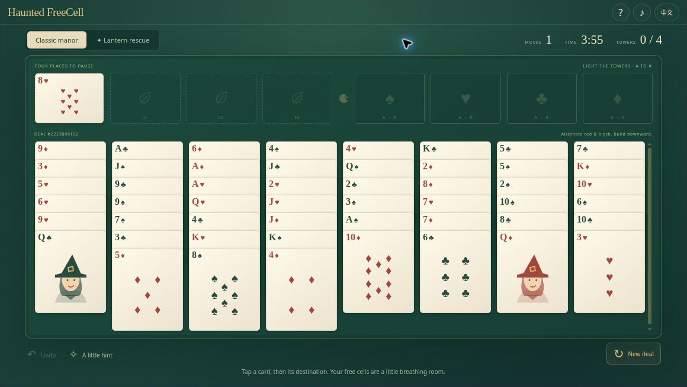
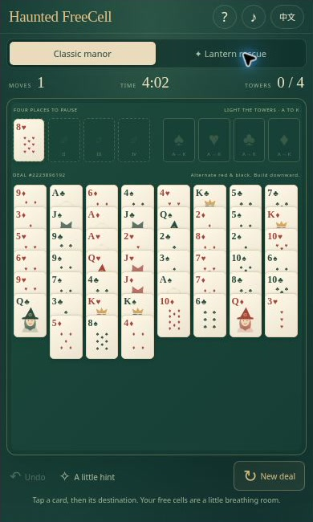

[English](README.md) · [简体中文](README.zh-CN.md) · [Español](README.es.md) · [Português (Brasil)](README.pt-BR.md) · [日本語](README.ja.md)

# Haunted FreeCell｜万圣节空当接龙与灯笼救援残局

🕯️ 庄园静悄悄，国王变成了南瓜，四座暗塔等你点亮。**Haunted FreeCell** 是完整的 52 张牌空当接龙：能真实拖放，也能先选后放；既可玩经典牌局，也可挑战三道短小的灯笼救援残局。给纸牌腾一点空间，下一步就会亮起来。

**[立即试玩](https://halloween-freecell.crazy3d.org/)** · [浏览全部 12 款万圣节游戏](https://github.com/AshinTop/halloween-games) · [⭐ 在 GitHub 点亮 Star](https://github.com/AshinTop/halloween-freecell)

README 提供五种语言版本。**游戏界面目前仅支持英语和简体中文**；文档翻译不代表新增了对应界面语言。



## 这款游戏有什么特别

- 完整的 **52 张牌 FreeCell**：八列牌、四个单张空当、四个同花色收牌区，遵守整组移动的中转容量限制。
- 支持鼠标和触屏拖放单牌或有序牌组，也保留点选移动；无效落点和取消拖动都不会改变局面。
- **三道经过完整解法验证的残局**，另有带种子的经典牌局、本次会话内无限撤销和合法一步提示。
- 猫咪 J、女巫 Q、南瓜 K 等原创图案，可选合成音效，以及随花色收齐而点亮的塔楼。
- **有完整证明才启动的自动终局收牌**：可以停止，也能一次撤销整批收牌。

## 怎么玩

把四个花色分别按 **A 到 K** 放进收牌区。牌列按点数递减、红黑交替摆放；空列可以放任意牌，每个空当只暂存一张。整组移动要求牌组本身有序，并有足够中转空间：`（空当数量 + 1）× 2^(可用空列数量)`。如果目的地本身是空列，它不能计入中转空列。符合规则时，收牌区的牌也可以移回。

灯笼救援采用相同规则，包含**西塔、月光舞会、最后一根蜡烛**三道固定残局。每关都有已验证的完整解法；建议步数是友好的挑战目标，不代表理论最少步数。

### 自动收牌，也保留反悔的机会

一次手动移动成功后，游戏会在局面的独立副本上检查：**所有剩余牌是否都能只靠合法进入收牌区而完成**。只能走通一部分不会启动自动收牌。证明完整后，牌逐张飞回，每张仍计为正常一步。动画按每张最多约 130 毫秒安排，较长批次的设定总时长约四秒；减少动态效果会去掉飞行动画。

**停止**或 **Esc** 会停在当前局面。按一次**撤销**可恢复自动收牌整批开始前的局面和步数，且不会立刻再次自动收牌；想继续时点**自动完成**。已经具备收尾条件的存档也会显示该按钮。普通中局撤销不会关闭以后再次自动收牌的能力。换牌局、重来、打开帮助、切语言、改变窗口大小、隐藏页面或离开窗口，都会安全取消正在进行的收牌。

## 操作方式

| 操作 | 输入方式 |
| --- | --- |
| 移动单牌或合法牌组 | 拖动并松开，或先选牌再点目的地 |
| 尝试快速进入收牌区 | 双击／双点暴露的单张牌 |
| 撤销／提示 | **U**／**H**，或对应按钮 |
| 停止收牌／取消拖动 | **Esc**；自动收牌时也有停止按钮 |
| 继续已证明的收尾 | 点击“自动完成” |
| 滚动长牌列 | 滚动箭头、滚轮，或在空隙／不可移动牌上滑动；拖到上下边缘也会自动滚动 |

## 一点小策略

尽量留一个空当，它不只是临时停车位，也决定长牌组能否整体搬动。移动国王前，看看下面是不是压着正需要的王后。自动收牌会等到再也不用安排牌列时才启动；前面的腾挪仍由你决定。

## 存档与挑战链接

存储可用时，当前牌局、用时、提示数、偏好和残局最佳成绩保留在本地。撤销历史仅属于本次页面会话，没有跨设备账号同步。可分享[经典牌局 12345](https://halloween-freecell.crazy3d.org/?deal=12345)或[灯笼救援 1](https://halloween-freecell.crazy3d.org/?puzzle=1)，把 puzzle 改成 2、3 可打开另外两关。分享采用实际结果；复制功能不可用时显示文字。

## 实机界面截图与视频介绍



实际游戏在紧凑浏览器 iframe 中的截图，用于展示小窗口布局，不代表实体手机测试。

[打开视频播放器与文字介绍](https://halloween-freecell.crazy3d.org/intro.html) · [下载 MP4](docs/media/intro.mp4)

**24 秒无声介绍视频**由真实游戏截图与字幕编排而成，用于介绍画面与玩法，并非连续操作录像或音效演示。

## 常见问题

### 提示是否保证一定能赢？

不保证。提示只给出当前合法的一步，不是整局求解器。三道固定残局已验证有解，但任意经典牌局不承诺都能通关。

### 空列能接收任意一叠牌吗？

不能。牌组要点数递减、红黑交替，还需有足够空当与可用空列支持搬运。

### 撤销会把时间、提示数和最高记录也倒退吗？

不会。它恢复局面与步数；自动收牌可整批撤回，但实际经过的时间、已使用提示和已经获得的最佳记录不会抹去。

## 本地运行与嵌入

在仓库根目录启动 HTTP 服务：

```sh
python3 -m http.server 4173
```

打开 **http://localhost:4173/**。无需构建或安装依赖；直接使用 `file://` 可能阻止 JavaScript 模块加载。

使用 Node 运行内置检查：

```sh
npm test
```

Node 检查涵盖整副牌守恒、中转容量、收牌区可逆性、残局解法、拖放与边缘滚动、手势取消、完整胜利证明、停止、整批撤销、减少动态效果和过期回调隔离。它们与实际浏览器验收互相补充。

```html
<iframe src="https://halloween-freecell.crazy3d.org/?embed=1"
  title="Haunted FreeCell"
  style="display:block;width:100%;height:654px;border:0"
  allow="fullscreen" allowfullscreen></iframe>
```

桌面基线是 **1160×654 CSS 像素**。短窗口把滚动留在牌列内部，空当、收牌区和工具保持可用。滚动箭头和拖放边缘滚动帮助你够到长牌列，而不是把每张牌都缩成细条。

尺寸、存储、焦点和权限说明见[嵌入文档](EMBEDDING.md)。请按扣除主站工具栏后的实际剩余高度设置 iframe。

## 继续逛逛万圣节小游戏集

- **[Trick-or-Treat TriPeaks](https://halloween-tripeaks.crazy3d.org/)** · [源码](https://github.com/AshinTop/halloween-tripeaks) — 串连相邻点数纸牌，挑战八个营救牌局。
- **[Pumpkin Shift](https://halloween-pumpkin-shift.crazy3d.org/)** · [源码](https://github.com/AshinTop/halloween-pumpkin-shift) — 滑动数字方块，利用有限的月光滑移通过 12 个房间。
- **[Haunted Hearts](https://halloween-love-game.crazy3d.org/)** · [源码](https://github.com/AshinTop/halloween-love-game) — 帮助两只幽灵开门、让路，并分享一盏灯。
- **[Pumpkin 2048](https://halloween-2048.crazy3d.org/)** · [源码](https://github.com/AshinTop/halloween-2048) — 合成南瓜数字，挑战指定落点的灯笼试炼。

## 创作说明与支持

为 **AshinTop** 与 **Midnight Candy Club** 制作，由人主导、AI 辅助设计、编程和审查。插画与合成音效为本项目创作。游戏无需远程账号；托管服务可以独立加入脚本或请求日志。

喜欢的话，欢迎**[点亮 GitHub Star](https://github.com/AshinTop/halloween-freecell)**。反馈问题时，请附浏览器、iframe 尺寸、挑战链接与复现步骤。
